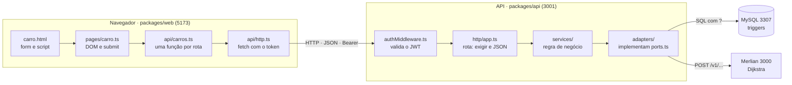

# AMPS — Aula para a prova de autoria

Material de estudo da equipe para a prova de autoria. Versão para apresentar: o Claude Doc "AMPS — Aula para a prova de autoria". Os números de linha valem para o commit em que este arquivo entrou; se o código mudar, confira com `grep -n`.

## 0. Como usar esta aula

Toda funcionalidade do AMPS percorre o mesmo fio: tela HTML → script da página → cliente HTTP → rota Express → serviço → repositório → SQL, e volta pelo mesmo caminho. Quem sabe seguir esse fio uma vez acha qualquer resposta na prova.

A aula tem três camadas. A **arquitetura** (seção 1) diz em que pasta cada coisa mora. A **sintaxe** (seção 2) explica cada construção de TypeScript, Express e SQL que aparece no código. Os **dois exemplos linha a linha** (seções 3 e 4) mostram o fio inteiro; a seção 5 dá o mapa para refazer o mesmo caminho nos outros fluxos.

### Receita para responder "onde está e o que faz"

1. **Comece pela tela.** Cada HTML carrega um único script de página:

| Tela (URL) | HTML | Script da página |
| --- | --- | --- |
| Login, cadastros e home | `packages/web/index.html` | `src/pages/login.ts`, `cadastroCliente.ts`, `cadastroDono.ts`, `home.ts` |
| Pesquisa de estacionamento | `client/search.html` | `src/pages/busca.ts` |
| Estacionamento publicado (visão do cliente) | `client/estacionamento-publicado.html` | `src/pages/estacionamentoPublicado.ts` |
| Mapa e recomendação | `client/mapa.html` | `src/client-map/mapa.ts` |
| Meu carro | `client/carro.html` | `src/pages/carro.ts` |
| Perfil | `client/perfil.html` | `src/pages/perfil.ts` |
| Meus estacionamentos (dono) | `owner/meus-estacionamentos.html` | `src/pages/meusEstacionamentos.ts` |
| Editor de pátio | `owner/editor.html` | `src/editor/editor.ts` |
| Métricas | `owner/metricas-estacionamentos.html` | `src/pages/metricasEstacionamentos.ts` |

2. **No script da página, ache a chamada à API.** Ela sempre passa por uma função de `src/api/*.ts` (por exemplo `cadastrarCarro`), que monta a URL e chama `pedir` (ou `pedirAutenticado`) em `src/api/http.ts`.
3. **Ache a rota na API.** Todas estão em `packages/api/src/http/app.ts`. Procure pelo método e caminho: `grep -n "app.post('/carros'" packages/api/src/http/app.ts`.
4. **Siga o serviço.** A rota chama `deps.<algo>Service.<metodo>`; o serviço está em `packages/api/src/services/<algo>Service.ts`.
5. **Siga o repositório.** O serviço recebe repositórios pelo construtor, tipados pelas interfaces de `ports.ts`. A implementação real está em `packages/api/src/adapters/mysql/mysql<Algo>Repository.ts`, com o SQL numa constante no topo do arquivo.
6. **Volte.** O repositório devolve um objeto de domínio (camelCase), o serviço devolve à rota, a rota converte para JSON (snake\_case) e o front desenha o resultado na tela.

### Como os arquivos do front são nomeados

A pasta diz o papel e o nome diz o assunto. Por isso o mesmo nome aparece em mais de uma pasta: em `src/api/` fica a chamada HTTP, e na outra pasta fica a tela ou a peça de interface.

| Nome | Em `src/api/` | Em outra pasta |
| --- | --- | --- |
| `mapa.ts` | Chamadas do mapa, do editor, da publicação e da recomendação | `client-map/mapa.ts`: script da tela do mapa do cliente |
| `perfil.ts` | Chamadas de `/perfil` | `pages/perfil.ts`: script da tela de perfil |
| `estacionamentos.ts` | Chamadas de `/estacionamentos` e `/busca` | Nenhum arquivo com esse nome; as telas são as duas abaixo |
| `card.ts` | Nenhum | `busca/card.ts` (card do resultado da busca) e `historico/card.ts` (card dos pátios visitados) |
| `index.ts` | Reexporta tudo de `api/` | `auth/index.ts` (sessão no `localStorage`) e `historico/index.ts` (pátios visitados) |

As duas telas de estacionamento têm nomes que dizem para quem são:

- `client/estacionamento-publicado.html` + `pages/estacionamentoPublicado.ts`: a ficha de **um** pátio publicado, vista pelo cliente.
- `owner/meus-estacionamentos.html` + `pages/meusEstacionamentos.ts`: a lista dos pátios **do dono**, onde ele cria, edita e exclui.

### Atalhos de busca

- `grep -rn "nomeDaFuncao" packages/` acha quem define e quem chama.
- No VS Code, **F12** vai para a definição e **Shift+F12** lista quem usa.
- Erro na tela? Procure a mensagem: `grep -rn "Preencha a placa e selecione" packages/`.
- Regra de negócio (RN-xx)? As regras estão em `docs/03-regras-de-negocio.md`; procure o comportamento no serviço correspondente.

### Como responder ao professor

Uma boa resposta tem três partes: **o que** acontece (comportamento), **onde** (arquivo e função) e **por quê** (a regra ou decisão de arquitetura por trás). Exemplo: "Placa duplicada devolve 409. O MySQL rejeita com errno 1062 pela UNIQUE de `carros.placa`, o `MysqlCarroRepository` traduz isso em `ConflictError` com `asConflict`, e o `errorHandler` mapeia `ConflictError` para 409."

## 1. Arquitetura

O AMPS é uma aplicação web em três peças que conversam por HTTP: o **front** (`packages/web`), a **API** (`packages/api`) e o **motor de grafo Merlian** (outro repositório, porta 3000). O MySQL só é acessado pela API.

### As peças e quem fala com quem

| Peça | Tecnologia | Porta | Responsabilidade |
| --- | --- | --- | --- |
| Front | TypeScript puro (sem framework) + Vite + Konva | 5173 | Telas HTML, formulários, desenho do mapa e do editor |
| API | Node.js + Express 5 + TypeScript | 3001 | Autenticação, regras de negócio, persistência |
| Banco | MySQL 8 em Docker (`docker-compose.yml`) | 3307 | Usuários, donos, modelos, carros, estacionamentos, topologias, vagas |
| Merlian | Serviço HTTP stateless (repo à parte) | 3000 | Dijkstra, alcançabilidade e score da vaga |

O front **nunca** fala com o banco nem com o Merlian: tudo passa pela API. A API chama o Merlian em dois momentos: ao **publicar** um estacionamento (verifica se toda vaga é alcançável, RN-11) e ao **recomendar** uma vaga.

### Monorepo com npm workspaces

O `package.json` da raiz declara `"workspaces": ["packages/*"]`. Um único `npm install` instala os dois pacotes, e `npm run dev` sobe API e front juntos (`trap 'kill 0' EXIT` derruba os dois no Ctrl+C). Os dois herdam o `tsconfig.base.json` (modo strict, `exactOptionalPropertyTypes`, `noUncheckedIndexedAccess`).

### Camadas da API (arquitetura hexagonal, ou ports and adapters)

A API é dividida em camadas que só conhecem a camada de baixo por meio de **interfaces**:

1. **HTTP** — `src/http/app.ts`. Cada rota lê `req`, valida o corpo (`exigir`), chama **um** serviço e converte o resultado em JSON. Não tem regra de negócio nem SQL.
2. **Serviços** — `src/services/*.ts`. A regra de negócio: quem pode fazer o quê, hash de senha, montar o pedido ao Merlian. Recebem os repositórios pelo construtor.
3. **Ports** — `src/ports.ts`. Só interfaces e tipos: `UsuarioRepository`, `CarroRepository`, `MotorDeGrafo` etc. É o contrato entre o serviço e o mundo externo.
4. **Adapters** — `src/adapters/mysql/` (um arquivo por repositório, SQL numa constante no topo) e `src/adapters/merlian/` (cliente HTTP do Merlian). Implementam as interfaces de `ports.ts`.

Por que assim? O serviço depende de `CarroRepository` (uma interface), não de MySQL. No teste unitário passamos um repositório falso em memória; trocar MySQL por Postgres, ou o Merlian por outro motor, mexe só no adapter. Isso é **inversão de dependência** (o "D" do SOLID).



A resposta faz o caminho inverso: o adapter devolve um objeto de domínio, a rota o converte em JSON e o front desenha o resultado. A regra de negócio mora só nos serviços, em destaque.

### Composição: onde tudo é ligado

`src/composition.ts` é o único lugar que faz `new` nos repositórios e serviços. A função `montarApp` cria um `MysqlCarroRepository(pool)`, passa para `new CarroService(carros, usuarios)` e entrega tudo a `createApp(deps)`. O `main.ts` só lê o `.env`, cria o pool do MySQL e o `MerlianMotorDeGrafo`, chama `montarApp` e faz `app.listen`. Os testes de integração usam a mesma `montarApp`, então testam a mesma fiação que roda em produção.

### Erros: do banco até o status HTTP

O serviço ou o adapter **lança** uma classe de `src/errors.ts`; o `errorHandler` (`src/http/errorHandler.ts`, registrado por último com `app.use(errorHandler)`) converte em status. No Express 5, erro lançado dentro de rota `async` chega sozinho ao `errorHandler`, sem `try/catch` na rota.

| Classe | Status | Quem lança, exemplo |
| --- | --- | --- |
| (rota responde direto) | 400 | `exigir` quando falta campo; `idDaRota` quando `:id` não é inteiro |
| (middleware responde direto) | 401 | `autenticar` sem token ou com token inválido; login com senha errada |
| `ForbiddenError` | 403 | `AcessoDono` quando o estacionamento é de outro dono (RN-10) |
| `NotFoundError` | 404 | Estacionamento ou carro inexistente |
| `ConflictError` | 409 | `asConflict` traduz o errno 1062 (UNIQUE violada) do MySQL |
| `UnprocessableError` | 422 | `asRegraDoBanco` traduz trigger (errno 1644) e CHECK (3819); Merlian recusando o grafo |
| `UnavailableError` | 503 | Merlian fora do ar |
| qualquer outro | 500 | Bug: `{ erro: 'erro interno' }` |

### Autenticação em uma frase

O login devolve um **JWT** assinado com HS256 (`src/security/jwt.ts`, biblioteca `jose`) cujo `sub` é o id do usuário. O front guarda o token no `localStorage` (`src/auth/index.ts`, chave `amps:session`) e o manda no cabeçalho `Authorization: Bearer <token>`. Na API, o middleware `autenticar` (`src/http/authMiddleware.ts`) valida o token e põe as claims em `req.auth`. A senha é guardada como hash **argon2id** (`src/security/password.ts`), nunca em texto.

### Front

Não há React nem Vue. Cada tela é um HTML estático com **um** `<script type="module">` que aponta para um arquivo de `src/pages/` (ou `src/editor/editor.ts`, `src/client-map/mapa.ts`). O Vite serve esses arquivos no dev e os empacota no build (`vite.config.ts` lista as 9 páginas).

| Pasta | Papel |
| --- | --- |
| `src/pages/` | Um script por tela: lê o formulário, chama a API, mexe no DOM |
| `src/api/` | Cliente HTTP. `http.ts` tem `pedir` e `pedirAutenticado`; os outros arquivos têm uma função por rota e os tipos de wire em snake\_case |
| `src/auth/` | Sessão no `localStorage` e quais menus cada tipo de conta vê |
| `src/dom/` | Peças de UI reutilizadas: menu (`navegacao.ts`), mensagens, endereço |
| `src/graph/` | Modelo do grafo `{nodes, edges}`, geometria e o desenho com Konva (`render/`) |
| `src/editor/` | Editor de pátio do dono: estado, ferramentas, gravação |
| `src/client-map/` | Mapa do cliente, vagas e recomendação |
| `src/e2e/` | Testes que dirigem um Chromium de verdade |

### Testes

| Comando | O que roda | Precisa de |
| --- | --- | --- |
| `npm test` | Unitários (`*.test.ts`) com Vitest, depois do `typecheck` | Nada |
| `npm run test:integration` | `*.integration.test.ts`: repositórios e rotas contra o MySQL real (apaga as tabelas) | Banco de pé |
| `npm run test:e2e` | `*.e2e.test.ts`: Chromium headless com clique e tecla reais | `npm run dev` rodando |

## 2. Sintaxe

Cada construção abaixo foi tirada do próprio código, com o arquivo e a linha. Se o professor apontar uma linha e perguntar "o que é isso?", a resposta está numa destas tabelas. Caminhos da API começam em `packages/api/src/`; os do front, em `packages/web/src/`.

### 2.1 TypeScript: tipos

| Construção | Exemplo real | Onde | O que significa |
| --- | --- | --- | --- |
| `interface` | `interface Carro { readonly id: number; readonly placa: string; ... }` | `ports.ts:48` | Descreve a forma de um objeto. Só existe na compilação; some no JavaScript gerado |
| `readonly` | `readonly placa: string` | `ports.ts:50` | O campo não pode ser reatribuído depois de criado |
| `extends` em interface | `interface UsuarioComSenha extends Usuario` | `ports.ts:11` | Herda todos os campos de `Usuario` e acrescenta `senhaHash` |
| União de literais | `type TipoConta = 'common_user' \| 'dono' \| 'p_admin'` | `ports.ts:1` | A variável só aceita um desses três textos. Espelha o `ENUM` do MySQL |
| `T \| null` | `findById(id: number): Promise<Usuario \| null>` | `ports.ts:171` | Pode não achar. O modo strict obriga a testar `if (usuario === null)` antes de usar |
| `Promise<T>` | `create(novo: NovoCarro): Promise<Carro>` | `ports.ts:189` | Função assíncrona que, quando terminar, entrega um `Carro` |
| `unknown` | `readonly grafo: unknown` | `ports.ts:103` | "Qualquer coisa, mas você tem que checar antes de usar". Mais seguro que `any` |
| `as` (asserção) | `const resposta = corpo as RespostaRecomendacao` | `adapters/merlian/merlianMotorDeGrafo.ts:68` | Diz ao compilador qual é o tipo. Não converte nem valida nada em tempo de execução |
| Type guard | `function isTipoConta(value: unknown): value is TipoConta` | `security/jwt.ts:23` | Se a função devolve `true`, o compilador passa a tratar `value` como `TipoConta` |
| Generics | `export async function pedir<T>(caminho: string, ...): Promise<T>` | web `api/http.ts:19` | `T` é um tipo-parâmetro: `pedir<CarroWire>(...)` devolve `Promise<CarroWire>` |
| Generic com restrição | `function exigir<C extends string>(req, res, campos: readonly C[]): Record<C, string> \| null` | `http/app.ts:44` | Chamando `exigir(req, res, ['placa'])`, o retorno tem exatamente o campo `placa` |
| `Record<K, V>` | `Record<string, unknown>` | `http/app.ts:37` | Objeto com chaves do tipo `K` e valores do tipo `V` |
| `as const` | `const CAMPOS_ENDERECO = ['cep', 'logradouro', ...] as const` | `http/app.ts:69` | Congela o array: o tipo vira a tupla exata de textos, não `string[]` |
| `(typeof X)[number]` | `Record<(typeof CAMPOS_ENDERECO)[number], string \| null>` | `http/app.ts:81` | "Qualquer elemento do array": a união `'cep' \| 'logradouro' \| ...` |
| `import type` | `import type { Carro, CarroRepository } from '../ports.js'` | `services/carroService.ts:2` | Importa só o tipo; a linha some no JS (`verbatimModuleSyntax` exige separar) |
| `.js` no import da API | `from '../errors.js'` | `services/carroService.ts:1` | Node em modo ESM (`NodeNext`) exige a extensão do arquivo compilado. O front, com Vite (`Bundler`), importa sem extensão |

### 2.2 Classes, herança e injeção de dependência

```ts
// services/carroService.ts:9-13
export class CarroService {
	constructor(
		private readonly carros: CarroRepository,
		private readonly usuarios: UsuarioRepository,
	) {}
```

- **Parameter properties.** `private readonly carros` no construtor declara o campo e já atribui `this.carros = carros`. Por isso o corpo `{}` fica vazio.
- **Injeção de dependência.** A classe recebe o repositório pronto, tipado pela interface; quem cria é o `composition.ts`.
- **`implements`.** `class MysqlCarroRepository implements CarroRepository` (`adapters/mysql/mysqlCarroRepository.ts:29`): o compilador obriga a classe a ter todos os métodos da interface.
- **`extends Error` e `super`.** Em `errors.ts:1-6`, `ConflictError` estende `Error`; o construtor chama `super(mensagem)` (o construtor de `Error`) e define `this.name`. Assim `error instanceof ConflictError` funciona no `errorHandler`.
- **`private async`.** `private async post(rota, corpo)` (`merlianMotorDeGrafo.ts:79`): método só visível dentro da classe.

```ts
// errors.ts:1-6
export class ConflictError extends Error {
	constructor(readonly campo: string) {
		super(`ja existe registro com ${campo}`);
		this.name = 'ConflictError';
	}
}
```

### 2.3 JavaScript moderno

| Construção | Exemplo real | Onde | O que faz |
| --- | --- | --- | --- |
| Arrow function | `carros.find((item) => item.id === carroId)` | `services/carroService.ts:45` | Função curta; aqui devolve o primeiro carro com aquele id, ou `undefined` |
| `async` / `await` | `const usuario = await this.usuarios.findById(usuarioId);` | `services/carroService.ts:17` | Pausa a função até a `Promise` resolver, sem travar o servidor |
| `try / catch / finally` | `try { await cadastrarCarro(...) } catch (erro) { relatar(erro) } finally { ... }` | web `pages/carro.ts:175-188` | `finally` roda com sucesso ou erro: reabilita o botão nos dois casos |
| IIFE assíncrona | `void (async () => { await carregarModelos(); ... })();` | web `pages/carro.ts:196` | Define e executa na hora uma função `async`. O `void` diz que ninguém espera o resultado |
| Desestruturação de array | `const [result] = await this.pool.execute(...)` | `mysqlCarroRepository.ts:34` | `execute` devolve `[resultado, campos]`; pegamos só o primeiro |
| Desestruturação de objeto | `const { usuario, dono } = await deps.donoService.cadastrar(dados);` | `http/app.ts:226` | Tira duas propriedades do objeto em variáveis |
| Spread de objeto | `{ ...usuarioWire(usuario), dono: { ... } }` | `http/app.ts:227-230` | Copia todos os campos de um objeto para dentro de outro |
| Spread condicional | `...(error.vagas.length === 0 ? {} : { vagas: error.vagas })` | `http/errorHandler.ts:26` | Só inclui a chave `vagas` no JSON se houver vagas |
| Template literal | crase com `${BASE_URL}${caminho}` dentro | web `api/http.ts:22` | Texto com expressões embutidas |
| Propriedade abreviada | `JSON.stringify({ placa, modelo_id: modeloId })` | web `api/carros.ts:23` | `{ placa }` é o mesmo que `{ placa: placa }` |
| Optional chaining `?.` | `placa?.value.trim()` | web `pages/carro.ts:163` | Se `placa` for `null`, a expressão dá `undefined` em vez de erro |
| Nullish coalescing `??` | `placa?.value.trim() ?? ''` | web `pages/carro.ts:163` | Valor padrão só quando o da esquerda é `null` ou `undefined` (diferente de `\|\|`, que também troca `0` e `''`) |
| `?.[i]` | `const token = match?.[1];` | `http/authMiddleware.ts:17` | Indexa só se `match` não for `null` |
| Regex | `const BEARER = /^Bearer (.+)$/;` e `BEARER.exec(...)` | `http/authMiddleware.ts:12,16` | Casa o texto inteiro "Bearer xxx"; o grupo `(.+)` captura o token em `match[1]` |
| `Set` | `new Set(vagas.map((vaga) => vaga.noId)).size !== vagas.length` | `http/app.ts:169-170` | Set não guarda repetidos: se o tamanho diminuiu, havia `no_id` duplicado |
| `Number` e `Number.isInteger` | `const carroId = Number(req.params.id); if (!Number.isInteger(carroId) ...)` | `http/app.ts:389-390` | Converte texto em número e confere se é inteiro (`Number('abc')` dá `NaN`) |
| `===` | `if (usuario === null)` | `services/carroService.ts:18` | Comparação estrita, sem conversão de tipo. O projeto nunca usa `==` |

### 2.4 Express

```ts
// http/app.ts:208-212
export function createApp(deps: AppDeps): Express {
	const app = express();
	app.use(cors({ origin: deps.corsOrigin }));
	app.use(express.json());
```

- `express()` cria a aplicação. `app.use(fn)` registra um **middleware** que roda em toda requisição, na ordem de registro.
- `cors({ origin })` põe o cabeçalho `Access-Control-Allow-Origin` só para `http://localhost:5173`. Sem ele o navegador bloqueia o front.
- `express.json()` lê o corpo JSON da requisição e o coloca em `req.body`.
- `app.post('/carros', autenticar(deps.tokenService), async (req, res) => { ... })` (`http/app.ts:363`): método HTTP, caminho e uma **cadeia** de funções. Primeiro roda `autenticar`; se ele chamar `next()`, roda o handler.
- Middleware tem a forma `(req, res, next) => { ... }` (`http/authMiddleware.ts:15`). Ou responde (`res.status(401)...; return;`) ou passa adiante com `next()`.
- Error handler tem **quatro** parâmetros, `(error, req, res, next)` (`http/errorHandler.ts:10`), e é registrado por último (`http/app.ts:582`).
- Leitura da requisição: `req.body` (corpo), `req.params['id']` (o `:id` da URL), `req.query['q']` (o `?q=` da URL), `req.header('authorization')`.
- Resposta: `res.status(201).json(objeto)` define o status e manda JSON; `res.status(204).send()` responde sem corpo.
- **Declaration merging** (`http/authMiddleware.ts:4-10`): `declare global { namespace Express { interface Request { auth?: TokenClaims } } }` acrescenta o campo `auth` ao tipo `Request` do Express, para `req.auth = claims` compilar.

### 2.5 SQL com mysql2

```ts
// adapters/mysql/mysqlCarroRepository.ts:12-15 e 34-38
const INSERT = `
INSERT INTO carros (placa, proprietario, modelo_id)
VALUES (?, ?, ?)
`;
const [result] = await this.pool.execute<ResultSetHeader>(INSERT, [
	novo.placa, novo.proprietario, novo.modeloId,
]);
```

- **`?` (placeholder).** `pool.execute` faz uma *prepared statement*: o SQL vai para o banco separado dos valores. Isso impede **SQL injection**, porque uma placa como `'); DROP TABLE carros;--` vira só texto.
- **`ResultSetHeader`** é o retorno de INSERT, UPDATE e DELETE: tem `insertId` (o `AUTO_INCREMENT` gerado) e `affectedRows`.
- **`RowDataPacket[]`** é o retorno de SELECT: `interface CarroRow extends RowDataPacket { id: number; placa: string; ... }` (`mysqlCarroRepository.ts:5-10`) tipa cada linha.
- **Pool** (`adapters/mysql/pool.ts`): até 10 conexões abertas e reaproveitadas, em vez de abrir uma por requisição.
- **Linha → domínio.** O banco usa `modelo_id` (snake\_case) e o domínio usa `modeloId` (camelCase); o `rows.map(row => ({ modeloId: row.modelo_id, ... }))` converte (`mysqlCarroRepository.ts:56-61`).
- **Consultas mais ricas** estão em `mysqlEstacionamentoRepository.ts:51-61`: `LEFT JOIN` com uma subconsulta `GROUP BY estacionamento_id` que conta vagas (`SUM(status = 'livre')`, `COUNT(*)`), e `LIKE CONCAT('%', ?, '%')` para a pesquisa por nome, cidade, bairro ou logradouro.
- DDL (`CREATE TABLE`, `UNIQUE`, `FOREIGN KEY`, `CHECK`, `TRIGGER`) está na seção 6.

### 2.6 DOM e navegador

| Construção | Exemplo real | Onde | O que faz |
| --- | --- | --- | --- |
| `querySelector<T>` | `document.querySelector<HTMLInputElement>('#placa')` | web `pages/carro.ts:22` | Acha o elemento pelo seletor CSS. Devolve `null` se não existir, por isso o código usa `placa?.` |
| `addEventListener` | `formNovo?.addEventListener('submit', async (event) => { ... })` | web `pages/carro.ts:159` | Registra a função que roda quando o formulário é enviado |
| `preventDefault()` | `event.preventDefault();` | web `pages/carro.ts:160` | Impede o navegador de recarregar a página ao enviar o form; quem envia é o `fetch` |
| `classList` | `formNovo?.classList.remove('disabled')` | web `pages/carro.ts:30` | Mostra ou esconde pela classe CSS `disabled` |
| `textContent` vs `innerHTML` | `placaCarro.textContent = carro.placa;` | web `pages/carro.ts:90` | `textContent` insere como texto puro: uma placa com `<script>` não executa (evita XSS) |
| `createElement` e `append` | `const item = document.createElement('li'); ... lista.appendChild(item);` | web `pages/carro.ts:83,126` | Monta a lista na mão, sem framework |
| `fetch` | `fetch(url, { ...init, headers: { ... } })` | web `api/http.ts:22` | Faz a requisição HTTP. Só rejeita se a rede falhar; 4xx e 5xx chegam com `resposta.ok === false` |
| `localStorage` | `localStorage.setItem(STORAGE_KEY, JSON.stringify(session))` | web `auth/index.ts:18` | Guarda texto no navegador, sobrevive a recarregar a página |
| `import.meta.env` | `import.meta.env['VITE_API_URL']` | web `api/http.ts:3` | Variável de ambiente injetada pelo Vite no build |
| `<script type="module">` | `<script type="module" src="../src/pages/carro.ts">` | web `client/carro.html:104` | Carrega o arquivo como módulo ES, permitindo `import` |

## 3. Exemplo 1 — Cadastro de carro, linha a linha

O cliente digita a placa, escolhe o modelo e clica em **Cadastrar**. São 9 paradas e 7 arquivos, e o fluxo passa por tudo: DOM, cliente HTTP, JWT, validação, serviço, repositório, SQL e tradução de erro.

| # | Parada | Arquivo | Linhas |
| --- | --- | --- | --- |
| 1 | Formulário HTML | `packages/web/client/carro.html` | 61-85, 104 |
| 2 | Carregar a tela e os modelos | `packages/web/src/pages/carro.ts` | 14-27, 46-62, 191-204 |
| 3 | Submit do formulário | `packages/web/src/pages/carro.ts` | 159-189 |
| 4 | Função da API no front | `packages/web/src/api/carros.ts` | 20-25 |
| 5 | `fetch` com token | `packages/web/src/api/http.ts` e `src/auth/index.ts` | 19-49 e 46-49 |
| 6 | Middleware de autenticação | `packages/api/src/http/authMiddleware.ts` | 14-32 |
| 7 | Rota `POST /carros` | `packages/api/src/http/app.ts` | 363-383 |
| 8 | Serviço | `packages/api/src/services/carroService.ts` | 16-27 |
| 9 | Repositório e SQL | `packages/api/src/adapters/mysql/mysqlCarroRepository.ts` | 12-15, 32-48 |

### Parada 1 — O HTML

```html
<!-- client/carro.html:61-85 -->
<form id="formNovo" class="formulario disabled" novalidate>
  <input type="text" id="placa" name="placa" maxlength="20" required autocomplete="off">
  <select id="modelo" name="modelo" required>
    <option value="">Selecione um modelo</option>
  </select>
  <button type="button" id="cancelarNovo">Cancelar</button>
  <button type="submit" id="salvarNovo">Cadastrar</button>
</form>
```

- `class="disabled"`: o formulário começa escondido; o botão "novo carro" (`#abrirNovo`) tira a classe.
- `novalidate`: desliga a validação nativa do navegador; quem valida é o TypeScript, para a mensagem sair no estilo do site.
- `maxlength="20"` acompanha a coluna `placa VARCHAR(20)` do banco.
- O `<select>` vem só com a opção vazia: os modelos são carregados pela API.
- `type="submit"` dispara o evento `submit` do form; `type="button"` não dispara.
- Linha 104: `<script type="module" src="../src/pages/carro.ts">` liga o HTML ao script.

### Parada 2 — Abrir a tela (`pages/carro.ts`)

```ts
// pages/carro.ts:21-23
const formNovo = document.querySelector<HTMLFormElement>('#formNovo');
const placa = document.querySelector<HTMLInputElement>('#placa');
const modelo = document.querySelector<HTMLSelectElement>('#modelo');
```

Nas linhas 14-27 o script pega uma referência para cada elemento pelo `id`. O genérico `<HTMLInputElement>` diz ao TypeScript que existe `.value`. Cada uma pode ser `null`, por isso o resto do arquivo usa `?.`.

```ts
// pages/carro.ts:191-204
if (getSession() === null) {
    bloquear('Entre com sua conta para ver seus carros.');
} else {
    area?.classList.remove('disabled');
    void (async () => {
        try {
            await carregarModelos();
            await carregarCarros();
        } catch (erro) {
            relatar(erro);
        }
    })();
}
```

- **191:** sem sessão no `localStorage`, não há token; mostra o aviso `#bloqueio` e para.
- **194:** com sessão, mostra a área da página.
- **196:** IIFE assíncrona. O código de topo de um módulo não pode esperar com `await` dentro do `if`, então cria e chama uma função `async` na hora.
- **198-199:** primeiro os modelos (a lista de carros precisa deles para mostrar "Fiat Mobi" no lugar do `modelo_id`), depois os carros.

```ts
// pages/carro.ts:46-62
async function carregarModelos(): Promise<readonly ModeloWire[]> {
    const modelos = await listarModelos();          // GET /modelos, rota pública
    modelosDisponiveis = modelos;
    if (modelo === null) return modelos;
    modelo.innerHTML = '<option value="">Selecione um modelo</option>';
    for (const item of modelos) {
        const option = document.createElement('option');
        option.value = String(item.id);             // o que vai para a API
        option.textContent = `${item.marca} ${item.nome}`;  // o que a pessoa vê
        modelo.appendChild(option);
    }
    return modelos;
}
```

O `value` de cada `<option>` é o **id** do modelo; o texto visível é marca e nome. Do lado da API, `GET /modelos` (`app.ts:278`) chama `ModeloService.listar` → `MysqlModeloRepository.listAll` → `SELECT id, marca, nome FROM modelos ORDER BY marca, nome`.

### Parada 3 — O submit

```ts
// pages/carro.ts:159-189
formNovo?.addEventListener('submit', async (event) => {
    event.preventDefault();
    limparMensagem(mensagem);

    const placaDigitada = placa?.value.trim() ?? '';
    const modeloId = Number(modelo?.value);

    if (placaDigitada === '' || !Number.isInteger(modeloId) || modeloId <= 0) {
        mostrarMensagem(mensagem, 'Preencha a placa e selecione um modelo.', 'error');
        return;
    }

    if (salvarNovo !== null) {
        salvarNovo.disabled = true;
    }

    try {
        await cadastrarCarro(placaDigitada, modeloId);
        fecharFormulario();
        mostrarMensagem(mensagem, 'Carro cadastrado com sucesso.', 'success');
        await carregarCarros();
    } catch (erro) {
        relatar(erro);
    } finally {
        if (salvarNovo !== null) {
            salvarNovo.disabled = false;
        }
    }
});
```

- **160** `preventDefault()`: sem isso o navegador faria um envio de formulário clássico e recarregaria a página.
- **163** `trim()` tira espaços das pontas; `?? ''` cobre o caso de `placa` ser `null`.
- **164** `Number('')` dá `0`, então "nenhum modelo escolhido" vira `0` e cai no `modeloId <= 0`.
- **166-169** validação no cliente, só para dar resposta rápida. A API valida de novo (parada 7), porque o front pode ser burlado.
- **172** desabilita o botão para evitar clique duplo e cadastro em dobro.
- **176** chama a API e espera. Se a resposta for erro, `cadastrarCarro` lança `ApiError` e o fluxo pula para o `catch`.
- **178-181** sucesso: fecha e limpa o form, mostra a mensagem verde e recarrega a lista do servidor.
- **182-183** `relatar` (linhas 145-157): se for `ApiError` com status 401, a sessão expirou, então apaga a sessão e bloqueia a tela; senão, mostra a mensagem de erro vinda da API (por exemplo "ja existe registro com placa").
- **184-187** `finally` reabilita o botão em qualquer caso.

### Parada 4 — A função de API (`api/carros.ts`)

```ts
// api/carros.ts:20-25
export function cadastrarCarro(placa: string, modeloId: number): Promise<CarroWire> {
    return pedirAutenticado<CarroWire>('/carros', {
        method: 'POST',
        body: JSON.stringify({ placa, modelo_id: modeloId }),
    });
}
```

Converte os parâmetros do front (camelCase) para o JSON da API (snake\_case: `modelo_id`). `CarroWire` (linhas 13-18) é o tipo da resposta, exatamente como a API a devolve.

### Parada 5 — `fetch` com o token (`api/http.ts`)

```ts
// api/http.ts:44-49
export function pedirAutenticado<T>(caminho: string, init: RequestInit = {}): Promise<T> {
    return pedir<T>(caminho, {
        ...init,
        headers: { ...authHeader(), ...(init.headers ?? {}) },
    });
}
```

`authHeader()` (`auth/index.ts:46-49`) lê a sessão do `localStorage` e devolve `{ Authorization: 'Bearer eyJ...' }`. Depois `pedir` (linhas 19-42) faz o trabalho:

- **22-25** `fetch` em `http://localhost:3001/carros` com `Content-Type: application/json`.
- **26-29** se o `fetch` rejeitar, a requisição nem chegou (API fora, CORS): lança `ApiError(0, 'Não foi possível falar com o servidor.')`.
- **31** lê o corpo como JSON; `.catch(() => null)` cobre resposta sem corpo, como o 204.
- **33-40** se `resposta.ok` for falso (status fora de 200-299), lança `ApiError` com o status e o campo `erro` do JSON.
- **41** sucesso: devolve o corpo com o tipo `T` (aqui, `CarroWire`).

### Parada 6 — Na API, o middleware `autenticar`

```ts
// http/authMiddleware.ts:12-32
const BEARER = /^Bearer (.+)$/;

export function autenticar(tokens: TokenService): RequestHandler {
	return async (req, res, next) => {
		const match = BEARER.exec(req.header('authorization') ?? '');
		const token = match?.[1];
		if (token === undefined) {
			res.status(401).json({ erro: 'token ausente' });
			return;
		}
		const claims = await tokens.verify(token);
		if (claims === null) {
			res.status(401).json({ erro: 'token invalido' });
			return;
		}
		req.auth = claims;
		next();
	};
}
```

- `autenticar` é uma **fábrica**: recebe o `TokenService` e devolve o middleware. É por isso que a rota escreve `autenticar(deps.tokenService)`.
- **16-17** extrai o token do cabeçalho. Sem cabeçalho, `?? ''` faz a regex falhar e `match` vira `null`.
- **23** `tokens.verify` (`security/jwt.ts:41-53`) confere a assinatura HS256 e a validade (8 h por padrão) e devolve `{ sub, tipoConta }` ou `null`.
- **29-30** grava as claims em `req.auth` e passa para o próximo handler.

### Parada 7 — A rota `POST /carros`

```ts
// http/app.ts:363-383
app.post('/carros', autenticar(deps.tokenService), async (req, res) => {
	const auth = autenticado(req, res);
	if (auth === null) return;

	const dados = exigir(req, res, ['placa']);
	if (dados === null) return;

	const modeloId = Number((req.body as Record<string, unknown>)['modelo_id']);
	if (!Number.isInteger(modeloId)) {
		res.status(400).json({ erro: 'campos obrigatorios ausentes', campos: ['modelo_id'] });
		return;
	}

	const carro = await deps.carroService.cadastrar(auth.sub, { placa: dados.placa, modeloId });
	res.status(201).json({
		id: carro.id,
		placa: carro.placa,
		modelo_id: carro.modeloId,
		proprietario: carro.proprietario,
	});
});
```

- **364** `autenticado` (linhas 98-104) só transforma `req.auth`, que é opcional no tipo, em `TokenClaims` garantido. Na prática o middleware já barrou quem não tem token.
- **367** `exigir` (linhas 44-67) percorre os campos pedidos; para cada um, `texto()` aceita só string não vazia. Faltando algum, responde `400 { erro: 'campos obrigatorios ausentes', campos: ['placa'] }` e devolve `null`, e a rota só faz `return`.
- **370** `modelo_id` é número, então não passa por `exigir` (que só trata texto): converte com `Number` e valida com `Number.isInteger`.
- **376** `auth.sub` é o id do usuário **tirado do token**, não do corpo. O cliente não tem como cadastrar carro em nome de outra pessoa.
- **377-382** status 201 (Created) e o carro em snake\_case.

### Parada 8 — O serviço

```ts
// services/carroService.ts:15-27
// O proprietario não vem do corpo: é o nome do usuario dono do token.
async cadastrar(usuarioId: number, dados: CadastroCarro): Promise<Carro> {
	const usuario = await this.usuarios.findById(usuarioId);
	if (usuario === null) {
		throw new NotFoundError('usuario');
	}
	return this.carros.create({
		placa: dados.placa,
		modeloId: dados.modeloId,
		proprietario: usuario.nome,
	});
}
```

- **17** busca o usuário do token. Se a conta foi apagada depois do login, lança `NotFoundError`, que vira 404.
- **22-26** monta um `NovoCarro` e delega ao repositório. O serviço não sabe que existe MySQL: `this.carros` é só um `CarroRepository`.

### Parada 9 — O repositório e o SQL

```ts
// adapters/mysql/mysqlCarroRepository.ts:32-48
async create(novo: NovoCarro): Promise<Carro> {
	try {
		const [result] = await this.pool.execute<ResultSetHeader>(INSERT, [
			novo.placa,
			novo.proprietario,
			novo.modeloId,
		]);
		return {
			id: result.insertId,
			placa: novo.placa,
			modeloId: novo.modeloId,
			proprietario: novo.proprietario,
		};
	} catch (error) {
		throw asConflict(error);
	}
}
```

- **34** executa `INSERT INTO carros (placa, proprietario, modelo_id) VALUES (?, ?, ?)` (linhas 12-15). A ordem do array tem que bater com a ordem dos `?`.
- **40** `result.insertId` é o `id` que o `AUTO_INCREMENT` acabou de gerar.
- **45-46** se o banco recusar, `asConflict` (`duplicate.ts:13-19`) olha o `errno`. Se for **1062** (duplicate entry, a `placa` é `UNIQUE`), extrai o nome da coluna da mensagem com a regex `/for key '(?:.*\.)?(.+)'/` e devolve `new ConflictError('placa')`. Qualquer outro erro passa como está.

### A volta

1. Sucesso: repositório → serviço → rota responde `201` com o JSON → `pedir` devolve o `CarroWire` → `carro.ts` mostra "Carro cadastrado com sucesso." e recarrega a lista com `GET /carros`.
2. Placa repetida: `ConflictError` sobe sem `try/catch` na rota → o Express 5 entrega ao `errorHandler` → `409 { erro: 'ja existe registro com placa', campo: 'placa' }` → `pedir` lança `ApiError(409, ...)` → `relatar` mostra a mensagem em vermelho.

### Pontos fracos que é bom saber explicar

- **Dono do carro pelo nome.** `proprietario` guarda `usuario.nome`, e `GET /carros` filtra por `WHERE proprietario = ?`. Dois usuários com o mesmo nome veriam os carros um do outro. O certo seria uma coluna `usuario_id` com FK para `usuarios`.
- **Modelo inexistente.** Um `modelo_id` que não existe viola a `FOREIGN KEY (modelo_id) REFERENCES modelos(id)` (errno 1452). `asConflict` só trata o 1062, então esse caso cai no 500 genérico. Pela tela isso não acontece, porque o `<select>` só oferece modelos existentes.

## 4. Exemplo 2 — Recomendação de vaga, linha a linha

Na tela do mapa, o cliente escolhe **carro**, **destino** (POI) e **entrada** e clica em **Encontrar vaga**. A API junta o grafo do pátio, as vagas livres e as medidas do carro e pede ao Merlian a melhor vaga e a rota. A recomendação é provisória (RN-15): **nada é gravado no banco**.

| # | Parada | Arquivo | Linhas |
| --- | --- | --- | --- |
| 1 | Chegar ao mapa | `packages/web/src/pages/estacionamentoPublicado.ts` | 96, 137 |
| 2 | Carregar e desenhar o pátio | `packages/web/src/client-map/mapa.ts` | 190-229 |
| 3 | Preencher os seletores | `packages/web/src/client-map/mapa.ts` | 66-70, 87-101, 131-138 |
| 4 | Submit | `packages/web/src/client-map/mapa.ts` | 142-187 |
| 5 | Função da API no front | `packages/web/src/api/mapa.ts` | 102-121 |
| 6 | Rota `POST /busca/:id/recomendacao` | `packages/api/src/http/app.ts` | 317-346 |
| 7 | Serviço: juntar os dados | `packages/api/src/services/recomendacaoService.ts` | 88-127 |
| 8 | Montar o pedido (função pura) | `packages/api/src/services/recomendacaoService.ts` | 40-73 |
| 9 | Adapter HTTP do Merlian | `packages/api/src/adapters/merlian/merlianMotorDeGrafo.ts` | 58-96 |
| 10 | O que o Merlian calcula | repo Merlian (fora deste repo) | RN-01, 04, 06, 07, 13, 14 |
| 11 | Desenhar a rota | `packages/web/src/graph/render/cena.ts` | 251-281, 393-398 |

### O grafo, antes de tudo

O pátio é um grafo `{ nodes, edges }` guardado como JSON na coluna `topologias.grafo`. Os tipos estão em `packages/web/src/graph/tipos.ts`:

| `role` do nó | Significado | Tipo TS |
| --- | --- | --- |
| `candidate` | Vaga (tem `dimensions: { width, length }` em metros) | `NoVaga` (linha 20) |
| `source` | Entrada do pátio, onde a rota começa | `NoEntrada` (linha 25) |
| `attractor` | Ponto de interesse (POI): loja, bloco, portão | `NoPoi` (linha 33) |
| `transit` | Ponto de via: cruzamento, curva | `NoVia` (linha 29) |

Cada aresta é `{ from, to, weight }` (linha 39): **direcionada**, com peso igual ao comprimento em metros. Mão dupla são duas arestas, uma em cada sentido (RN-07). `type No = NoVaga | NoEntrada | NoVia | NoPoi` (linha 37) é uma **união discriminada**: testando `no.role === 'candidate'`, o TypeScript sabe que existe `no.dimensions`. As chaves ficam em inglês porque o objeto vai para o Merlian sem tradução.

Além do grafo, a tabela `vagas` guarda o que o Merlian não conhece: número, tipo (`comum`, `pcd`...), rotação e `status` (`livre`, `ocupada`, `reservada`). A ligação é `vagas.no_id` = `node.id` do grafo.

### Parada 1 — Chegar ao mapa

Na página de detalhe, cada destino vira um link (`estacionamentoPublicado.ts:96`): `/client/mapa.html?id=${estacionamentoId}&destino=${encodeURIComponent(ponto.id)}`. O botão "ver mapa" (linha 137) leva só o `id`. `encodeURIComponent` escapa caracteres especiais do id do nó na URL.

### Parada 2 — Carregar e desenhar (`client-map/mapa.ts:190-229`)

```ts
// client-map/mapa.ts:21-23
const params = new URLSearchParams(window.location.search);
const id = Number(params.get('id'));
```

```ts
// client-map/mapa.ts:197-219
} else if (palcoDiv !== null) {
    void (async () => {
        try {
            if (voltar) voltar.href = `/client/estacionamento-publicado.html?id=${id}`;
            const [estacionamento, mapa] = await Promise.all([
                buscarEstacionamentoPublicado(id),
                carregarMapaPublicado(id),
            ]);
            document.title = `${estacionamento.nome} - Mapa - AMPS`;
            if (nomeDoPatio) nomeDoPatio.textContent = estacionamento.nome;

            const palco = criarPalco(palcoDiv);
            const cena = criarCena(palco);
            cena.modo('ligar');

            const grafo = comoGrafo(mapa.grafo);
            cena.desenhar(grafo, mapa.vagas.map(comoDadosDaVaga));
            cena.enquadrar();
            salvarHistorico(estacionamento);

            ligarPainel(cena, grafo);
            await prepararCarros();
            cena.enquadrar(cobertura());
```

- **190** se o `id` da URL não for inteiro positivo, mostra "Link inválido" e para.
- **201-204** `Promise.all` dispara as duas requisições **ao mesmo tempo** e espera as duas. A desestruturação `[estacionamento, mapa]` pega os resultados na ordem. As duas rotas são públicas (sem token): `GET /busca/:id` e `GET /busca/:id/mapa`.
- Na API, `GET /busca/:id/mapa` (`app.ts:305-315`) chama `MapaService.carregarPublicado` (`mapaService.ts:35-49`). Se o estacionamento não existe **ou não está publicado**, lança `NotFoundError` (404): rascunho responde como inexistente (RN-05). Depois busca a topologia (`SELECT versao, grafo FROM topologias WHERE estacionamento_id = ?`) e as vagas (`SELECT ... FROM vagas WHERE estacionamento_id = ?`). A resposta usa `vagaPublicaWire` (`app.ts:189-197`), que **omite** `carro_id` e `sensor`: o público não vê que carro está em qual vaga.
- **208-210** `criarPalco` cria o *stage* do Konva dentro da `<div id="palco">`; `criarCena` cria as camadas (vias, vagas, rota). O modo `'ligar'` é o de só visualizar.
- **212** `comoGrafo` (`tipos.ts:54-61`) confere que `nodes` e `edges` são arrays; senão usa um grafo vazio.
- **213-214** desenha nós, vias e vagas, e enquadra o pátio na tela.
- **215** `salvarHistorico` guarda o pátio no `localStorage` para a lista de "visitados recentemente" da home.

### Parada 3 — Preencher os seletores

```ts
// client-map/mapa.ts:66-70
function preencherComNos(seletor: HTMLSelectElement | null, grafo: Grafo, papel: Papel): void {
    if (seletor === null) return;
    const nos = grafo.nodes.filter((no) => no.role === papel);
    seletor.replaceChildren(...nos.map((no) => opcao(no.id, no.label ?? no.id)));
}
```

- `ligarPainel` (linha 131) chama isso duas vezes: `'attractor'` preenche o **destino** e `'source'` preenche a **entrada**. Os POIs oferecidos são os que o dono desenhou (RN-12).
- `replaceChildren(...lista)` apaga as opções antigas e coloca as novas; o `...` espalha o array como argumentos.
- `no.label ?? no.id`: mostra o nome do nó, ou o id se não houver nome.
- **136-138**: se a URL trouxe `?destino=`, e esse destino existe no seletor, já deixa selecionado.
- `prepararCarros` (linhas 87-101): sem sessão, mostra o aviso `#semConta`; senão faz `Promise.all([listarCarros(), listarModelos()])`. Sem carros, mostra `#semCarro`; com carros, preenche o `<select id="carro">` com "placa · marca modelo".

### Parada 4 — O submit (`client-map/mapa.ts:142-187`)

```ts
formVaga?.addEventListener('submit', async (evento) => {
    evento.preventDefault();
    if (!seletorDeCarro || !seletorDeDestino || !seletorDeEntrada) return;
    limparMensagem(avisoVaga);
    if (botaoEncontrar) botaoEncontrar.disabled = true;
    try {
        const resposta = await recomendarVaga(id, {
            carroId: Number(seletorDeCarro.value),
            poi: seletorDeDestino.value,
            entrada: seletorDeEntrada.value,
        });
        if (resposta.vaga === null) {
            cena.recomendar(null, []);
            mostrarMensagem(avisoVaga, 'Nenhuma vaga livre comporta esse carro agora. Tente de novo em alguns minutos.', 'error');
            return;
        }
        cena.recomendar(resposta.vaga.no_id, resposta.rota?.nos ?? []);
        const entrada = rotuloDoNo(grafo, seletorDeEntrada.value);
        const carro = seletorDeCarro.selectedOptions[0]?.textContent ?? '';
        mostrarResultado({
            numero: resposta.vaga.numero,
            detalhe: resposta.rota === null
                ? `A partir de ${entrada}`
                : `Cerca de ${Math.round(resposta.rota.peso_total)} m a partir de ${entrada}`,
            carro: carro.split(' · ')[0] ?? carro,
            destino: rotuloDoNo(grafo, seletorDeDestino.value),
            entrada,
        });
        cena.enquadrarRecomendacao(cobertura());
    } catch (erro) {
        mostrarMensagem(avisoVaga, erro instanceof ApiError ? erro.message : 'Não foi possível calcular a vaga.', 'error');
    } finally {
        if (botaoEncontrar) botaoEncontrar.disabled = false;
    }
});
```

- O `value` de cada seletor é o **id**: o id do carro no banco e os ids dos nós no grafo.
- **155-163** `vaga === null` é a RN-16: sem vaga livre compatível, o sistema avisa e oferece tentar de novo, sem inventar uma vaga.
- **165** `cena.recomendar` realça a vaga e desenha a rota (parada 11).
- **172** `peso_total` é a soma dos pesos das arestas da rota, em metros; `Math.round` arredonda.
- **173** o texto da opção é "ABC1D23 · Fiat Mobi"; `split(' · ')[0]` fica só com a placa. `?? carro` existe porque, com `noUncheckedIndexedAccess`, `[0]` pode ser `undefined` para o TypeScript.

### Parada 5 — A função de API (`api/mapa.ts:113-121`)

```ts
export function recomendarVaga(estacionamentoId: number, escolha: EscolhaDeVaga): Promise<RecomendacaoWire> {
    return pedirAutenticado<RecomendacaoWire>(`/busca/${estacionamentoId}/recomendacao`, {
        method: 'POST',
        body: JSON.stringify({ carro_id: escolha.carroId, poi: escolha.poi, entrada: escolha.entrada }),
    });
}
```

`pedirAutenticado` porque a rota exige login: a API precisa saber de quem é o carro. `RecomendacaoWire` (linhas 108-111) é `{ vaga: { no_id, numero } | null, rota: { nos, peso_total } | null }`.

### Parada 6 — A rota (`http/app.ts:317-346`)

```ts
app.post('/busca/:id/recomendacao', autenticar(deps.tokenService), async (req, res) => {
	const auth = autenticado(req, res);
	if (auth === null) return;
	const id = idDaRota(req, res);
	if (id === null) return;
	const dados = exigir(req, res, ['poi', 'entrada']);
	if (dados === null) return;
	const carroId = Number((req.body as Record<string, unknown>)['carro_id']);
	if (!Number.isInteger(carroId)) {
		res.status(400).json({ erro: 'campos obrigatorios ausentes', campos: ['carro_id'] });
		return;
	}
	const recomendada = await deps.recomendacaoService.recomendar(auth.sub, id, {
		carroId,
		poiId: dados.poi,
		entradaId: dados.entrada,
	});
	res.status(200).json({
		vaga: recomendada.vaga === null
			? null
			: { no_id: recomendada.vaga.noId, numero: recomendada.vaga.numero },
		rota: recomendada.rota === null
			? null
			: { nos: recomendada.rota.nos, peso_total: recomendada.rota.pesoTotal },
	});
});
```

Mesmo padrão do exemplo 1: autentica, valida `:id` com `idDaRota` (linhas 106-113), valida corpo com `exigir`, converte `carro_id` para número, chama **um** serviço e converte camelCase em snake\_case. Usa `POST` e não `GET` porque manda um corpo com a escolha.

### Parada 7 — O serviço junta os dados (`recomendacaoService.ts:88-127`)

O construtor (linhas 76-84) recebe **sete** dependências: cinco repositórios, o de modelos e o `MotorDeGrafo`. O método faz seis buscas antes de chamar o Merlian:

```ts
const estacionamento = await this.estacionamentos.findById(estacionamentoId);
if (estacionamento === null || !estacionamento.publicado) {
	throw new NotFoundError('estacionamento');
}
const usuario = await this.usuarios.findById(usuarioId);
if (usuario === null) throw new NotFoundError('usuario');
const carros = await this.carros.listByProprietario(usuario.nome);
const carro = carros.find((item) => item.id === escolha.carroId);
if (carro === undefined) throw new NotFoundError('carro');

const dimensoes = await this.modelos.findDimensoes(carro.modeloId);
if (dimensoes === null) throw new NotFoundError('modelo');

const topologia = await this.topologias.findByEstacionamento(estacionamento.id);
if (topologia === null) throw new NotFoundError('estacionamento');
const vagas = await this.vagas.listByEstacionamento(estacionamento.id);

const pedido = montarPedido(topologia.grafo, vagas, dimensoes, escolha);
const recomendacao = await this.motor.recomendar(pedido);

const vaga = vagas.find((item) => item.noId === recomendacao.vagaNoId);
return {
	vaga: vaga === undefined ? null : { noId: vaga.noId, numero: vaga.numero },
	rota: vaga === undefined ? null : recomendacao.rota,
};
```

| Linhas | O que faz | Por quê |
| --- | --- | --- |
| 93-96 | Estacionamento tem que existir e estar publicado | RN-05: rascunho é invisível ao cliente |
| 98-106 | O carro tem que ser do usuário do token | O cliente não pode usar o carro de outra pessoa; um id alheio dá 404 |
| 108-111 | Busca `largura_mm` e `comprimento_mm` do modelo | RN-13: a vaga tem que comportar o carro |
| 113-117 | Busca o grafo e as vagas do **mesmo** estacionamento | RN-02: só entram vagas do pátio consultado |
| 119 | Monta o pedido (parada 8) | Separado numa função pura para ser testado sem banco |
| 120 | Chama o Merlian pela interface `MotorDeGrafo` | O serviço não sabe que é HTTP |
| 122-126 | Traduz o `no_id` devolvido para o **número** da vaga ("A12") | O Merlian só conhece ids de nó; o número está na tabela `vagas` |

O comentário das linhas 86-87 é importante: "a recomendação é provisória. Nada é gravado aqui; reservar é do check-in". O check-in com reserva (RN-09, RN-15) ainda não está implementado.

### Parada 8 — `montarPedido`, a função pura (`recomendacaoService.ts:40-73`)

```ts
export function montarPedido(grafo, vagas, dimensoes, escolha): PedidoDeRecomendacao {
	const nos = nosDo(grafo);
	const papelDe = (id: string): unknown => nos.find((no) => no.id === id)?.role;

	if (papelDe(escolha.poiId) !== 'attractor') {
		throw new UnprocessableError('destino nao e um ponto de interesse deste estacionamento');
	}
	if (papelDe(escolha.entradaId) !== 'source') {
		throw new UnprocessableError('entrada nao existe neste estacionamento');
	}

	const oferecidas = new Set(
		vagas.filter((vaga) => vaga.status === 'livre' && vaga.tipo === 'comum').map((vaga) => vaga.noId),
	);
	const indisponiveis = nos
		.filter((no) => no.role === 'candidate' && typeof no.id === 'string' && !oferecidas.has(no.id))
		.map((no) => no.id as string);

	return {
		grafo,
		veiculo: { largura: dimensoes.larguraMm / 1000, comprimento: dimensoes.comprimentoMm / 1000 },
		indisponiveis,
		poiId: escolha.poiId,
		entradaId: escolha.entradaId,
	};
}
```

- **47** `papelDe` é uma arrow function local que acha o nó pelo id e devolve o `role`, ou `undefined` (pelo `?.`).
- **49-54** valida que o POI é mesmo um `attractor` e a entrada é um `source` **deste** grafo. Um id inventado vira 422.
- **56-58** `oferecidas` é o conjunto de vagas que podem ser recomendadas: `livre` (RN-01, RN-17: ocupada e reservada ficam fora) **e** `comum`. PCD, idoso, moto e elétrico ficam fora porque o AMPS ainda não sabe se o cliente tem direito (comentário das linhas 36-39).
- **59-61** `indisponiveis` é o inverso: todo nó `candidate` do grafo que **não** está em `oferecidas`. Isso inclui vaga desenhada sem linha na tabela `vagas` (rascunho). É essa lista que vai para o Merlian como `occupancy`. `Set.has` é uma busca de custo constante.
- **66-67** converte milímetros (catálogo de modelos) em metros (unidade do grafo). Sem isso a RN-14 quebra, porque o Merlian compara com 1,85 m e 4,5 m.
- Testada em `recomendacaoService.test.ts` sem banco e sem Merlian, porque só recebe dados e devolve dados.

### Parada 9 — O adapter do Merlian (`merlianMotorDeGrafo.ts:58-96`)

```ts
async recomendar(pedido: PedidoDeRecomendacao): Promise<Recomendacao> {
	const corpo = await this.post('/v1/recommendations', {
		graph: pedido.grafo,
		vehicle: { dimensions: { width: pedido.veiculo.largura, length: pedido.veiculo.comprimento } },
		occupancy: pedido.indisponiveis,
		poiId: pedido.poiId,
		entranceId: pedido.entradaId,
	});
	const resposta = corpo as RespostaRecomendacao;
	return {
		vagaNoId: resposta.slot?.id ?? null,
		rota: resposta.route?.nodes === undefined
			? null
			: { nos: resposta.route.nodes, pesoTotal: resposta.route.totalWeight ?? 0 },
	};
}
```

- O adapter **traduz** o domínio em português para o contrato em inglês do Merlian (`grafo` → `graph`, `indisponiveis` → `occupancy`) e a resposta de volta (`slot.id` → `vagaNoId`, `route.totalWeight` → `pesoTotal`).
- `post` (linhas 79-96) faz o `fetch` para `${baseUrl}/v1/recommendations`. Se a rede falhar, lança `UnavailableError` (503). Se o Merlian responder 400 ou 422, `comoRecusa` (linhas 28-40) junta as `issues` dele numa `UnprocessableError` (422). Qualquer outro status vira 503.
- `baseUrl` vem do `.env` (`loadMerlianConfig`, em `config/env.ts`), passado em `main.ts`.

### Parada 10 — O que o Merlian calcula

O código do Merlian está no repositório [Merlian](https://github.com/gengibrepower/Merlian), não neste. O comportamento está fixado nas regras de `docs/03-regras-de-negocio.md`:

1. **Filtra** as vagas: tira as de `occupancy` (RN-01) e as que não comportam `width` e `length` do veículo (RN-13).
2. **Dijkstra** sobre as arestas direcionadas (RN-07): distância de dirigir da entrada até cada vaga, e distância a pé da vaga até o POI.
3. **Score** (RN-04): cada fator é normalizado em \[0, 1\] entre as candidatas, depois ponderado. Distância a pé até o POI tem peso 1, ocupação da vizinhança (vagas a menos de 2× o comprimento da vaga) tem peso 1, e distância de dirigir tem peso 0,1. Vence o menor custo; empate vai para a menor ocupação e depois para o id.
4. **Viés por tamanho** (RN-14): para carro grande, o peso da ocupação cresce, preferindo vagas com menos vizinhas ocupadas.
5. Devolve `slot` (a vaga) e `route` (lista de nós da entrada até a vaga e o peso total), o caminho mais curto (RN-06).

```latex
\text{custo} = 1 \cdot \hat{d}_{\text{pé}} + w_{\text{ocup}} \cdot \hat{o} + 0{,}1 \cdot \hat{d}_{\text{dirigir}}, \qquad w_{\text{ocup}} = 1 + 2 \cdot \max\left(0,\ \frac{w}{1{,}85} - 1,\ \frac{l}{4{,}5} - 1\right)
```

O chapéu indica o valor normalizado em \[0, 1\]; `w` e `l` são largura e comprimento do carro em metros.

### Parada 11 — Desenhar a rota (`graph/render/cena.ts`)

```ts
// cena.ts:393-398
recomendar(vagaNoId: string | null, novaRota: readonly string[]): void {
    recomendada = vagaNoId;
    rota = novaRota;
    desenharRota();
    aplicarRealce();
},
```

- `desenharRota` (linhas 251-281) apaga a rota anterior (`camadaDaRota.destroyChildren()`), converte a lista de ids em pontos com `pontosDaRota` (`graph/rota.ts`) e transforma metros em pixels com `metrosParaPixels`.
- Desenha **duas** `Konva.Arrow` com os mesmos pontos: uma larga (o contorno) e uma fina por cima (a rota). O resultado é uma seta com borda.
- `pontosDaRota` desloca a linha para a faixa da direita de quem dirige (`rota.ts:18-29`, `deslocado`) e calcula as quinas onde dois trechos se encontram (`quina`, linhas 33-46, interseção de duas retas).
- `aplicarRealce` destaca a vaga recomendada; `enquadrarRecomendacao` dá zoom na rota, descontando a área coberta pelo painel (`cobertura()`, `mapa.ts:48-57`).

### Erros possíveis nesse fluxo

| Situação | Quem detecta | Resposta |
| --- | --- | --- |
| Sem login | `autenticar` | 401 |
| `carro_id` ausente ou não numérico | rota | 400 |
| Estacionamento inexistente ou rascunho | serviço, linha 94 | 404 |
| Carro de outra pessoa | serviço, linha 104 | 404 |
| POI ou entrada que não são deste grafo | `montarPedido` | 422 |
| Merlian recusa o grafo | `comoRecusa` | 422 |
| Merlian fora do ar | `post` | 503 |
| Nenhuma vaga compatível | Merlian devolve `slot: null` | 200 com `vaga: null` (RN-16) |

## 5. Mapa dos outros fluxos

Cada fluxo abaixo segue o mesmo fio dos exemplos. A tabela dá as paradas na ordem; os pontos depois dela são o que o professor tende a perguntar. Os caminhos do front começam em `packages/web/src/`, e os da API em `packages/api/src/`.

### 5.1 Cadastro de cliente

| Parada | Onde |
| --- | --- |
| Form `#client-form` | `packages/web/index.html` |
| Submit | `pages/cadastroCliente.ts:12-38` |
| API do front | `api/conta.ts:29-34` (`cadastrarCliente`, `pedir` sem token) |
| Rota `POST /usuarios` | `http/app.ts:214-220`, exige `nome`, `email`, `cpf`, `senha` |
| Serviço | `services/usuarioService.ts:16-25` |
| Repositório | `adapters/mysql/mysqlUsuarioRepository.ts`, `INSERT INTO usuarios` (linhas 18-21) |

- **Senha mínima:** `exigirSenhaValida` (`services/senha.ts:5-9`) recusa menos de 8 caracteres com `UnprocessableError` (422).
- **Hash:** `hashPassword` (`security/password.ts:6-11`) gera um hash **argon2id** com sal aleatório embutido. A senha em texto nunca chega ao banco; a coluna `usuarios.senha` guarda o hash.
- **Tipo de conta fixo:** `tipoConta: 'common_user'` está no serviço, não vem do corpo. Ninguém se cadastra como `p_admin` mandando um campo a mais.
- **Duplicado:** `email` e `cpf` são `UNIQUE` → errno 1062 → `ConflictError` → 409. O front troca a mensagem por "Já existe uma conta com esse e-mail ou CPF." (`cadastroCliente.ts:29-35`).

### 5.2 Cadastro de dono (com transação)

| Parada | Onde |
| --- | --- |
| Submit | `pages/cadastroDono.ts` |
| Rota `POST /donos` | `http/app.ts:222-231`, exige também `razao` e `cnpj` |
| Serviço | `services/donoService.ts:17-29` (`tipoConta: 'dono'`) |
| Repositório | `adapters/mysql/mysqlDonoRepository.ts:36-66` |

O dono são **duas linhas**, uma em `usuarios` e uma em `donos`, e as duas têm que entrar juntas:

```ts
// mysqlDonoRepository.ts:37-65
const connection = await this.pool.getConnection();
try {
	await connection.beginTransaction();
	const [result] = await connection.execute<ResultSetHeader>(INSERT_USUARIO, [...]);
	await connection.execute(INSERT_DONO, [result.insertId, dono.razao, dono.cnpj]);
	await connection.commit();
	return { ... };
} catch (error) {
	await connection.rollback();
	throw asConflict(error);
} finally {
	connection.release();
}
```

- Usa **uma conexão só** (`getConnection`), porque a transação vale por conexão; o `pool.execute` poderia usar uma conexão diferente a cada comando.
- `result.insertId` do primeiro INSERT vira o `usuario_id` do segundo.
- Se o CNPJ estiver duplicado, o segundo INSERT falha, o `rollback` desfaz o usuário, e não sobra usuário "dono" sem linha em `donos`. Isso é testado em `mysqlDonoRepository.integration.test.ts:85`.
- `finally { connection.release() }` devolve a conexão ao pool em qualquer caso.

### 5.3 Login e sessão

| Parada | Onde |
| --- | --- |
| Submit | `pages/login.ts:11-40` |
| API do front | `api/conta.ts:22-27` (`login`) |
| Rota `POST /auth/login` | `http/app.ts:233-247` |
| Serviço | `services/authService.ts:16-27` |
| Token | `security/jwt.ts:31-39` (`sign`) e `41-53` (`verify`) |
| Sessão no front | `auth/index.ts:17-19` (`saveSession`) e `46-49` (`authHeader`) |

```ts
// services/authService.ts:16-27
async login(email: string, senha: string): Promise<Autenticado | null> {
	const encontrado = await this.usuarios.findByEmail(email);
	if (encontrado === null) return null;
	if (!(await verifyPassword(senha, encontrado.senhaHash))) return null;
	const { senhaHash: _descartado, ...usuario } = encontrado;
	return { token: await this.tokens.sign(usuario), usuario };
}
```

- E-mail inexistente e senha errada devolvem o **mesmo** `null`, e a rota responde o mesmo 401 "credenciais invalidas". Assim um atacante não descobre quais e-mails têm conta.
- `verifyPassword` recalcula o argon2 com o sal guardado no hash e compara. Se o hash estiver corrompido, o `catch` devolve `false`.
- `const { senhaHash: _descartado, ...usuario } = encontrado` é **desestruturação com rest**: separa `senhaHash` e junta o resto em `usuario`. O hash nunca sai na resposta.
- O token (`sign`): payload `{ tipo_conta }`, `sub` = id do usuário (string, porque o padrão JWT exige), `iat`, `exp` de 8 h, assinado com HS256 e a chave `JWT_SECRET` do `.env`.
- O front grava `{ token, usuario }` em `localStorage['amps:session']`. Em toda chamada autenticada, `authHeader()` monta `Authorization: Bearer <token>`.
- **Logout** é só `clearSession()` (`auth/index.ts:34-36`): o JWT não tem estado no servidor, então não há o que invalidar lá. O token continua válido até expirar.
- **Menu por tipo de conta:** `auth/sessao.ts:10-14` (`POR_TIPO`) decide os itens do menu. O comentário das linhas 23-24 avisa: esconder menu **não** é segurança; quem protege é o 401/403 da API.

### 5.4 Pesquisa de estacionamento

| Parada | Onde |
| --- | --- |
| Tela | `client/search.html`, aberta como `search.html?q=termo` |
| Script | `pages/busca.ts:10-39` |
| API do front | `pesquisarEstacionamentos(q)` em `api/estacionamentos.ts` |
| Rota `GET /busca?q=` | `http/app.ts:285-295` (pública, sem token) |
| Serviço | `services/estacionamentoService.ts:36-38` (repassa ao repositório) |
| SQL | `adapters/mysql/mysqlEstacionamentoRepository.ts:46-65` e `143-150` |
| Card de resultado | `busca/card.ts` (link para `estacionamento-publicado.html?id=`, linha 104) |

```sql
-- mysqlEstacionamentoRepository.ts:46-65
SELECT e.id, e.dono_id, e.nome_estacionamento, e.publicado,
       e.cep, e.logradouro, e.numero, e.bairro, e.complemento, e.cidade, e.estado,
       COALESCE(v.livres, 0) AS vagas_livres, COALESCE(v.total, 0) AS vagas_total
FROM estacionamentos e
LEFT JOIN (
	SELECT estacionamento_id, SUM(status = 'livre') AS livres, COUNT(*) AS total
	FROM vagas
	GROUP BY estacionamento_id
) v ON v.estacionamento_id = e.id
WHERE e.publicado = 1
	AND (
		e.nome_estacionamento LIKE CONCAT('%', ?, '%') ESCAPE '!'
		OR e.cidade LIKE CONCAT('%', ?, '%') ESCAPE '!'
		OR e.bairro LIKE CONCAT('%', ?, '%') ESCAPE '!'
		OR e.logradouro LIKE CONCAT('%', ?, '%') ESCAPE '!'
	)
ORDER BY e.nome_estacionamento
LIMIT 50
```

- **Subconsulta com `GROUP BY`:** conta, por estacionamento, o total de vagas e as livres. `status = 'livre'` vale 1 ou 0 no MySQL, então `SUM` conta as livres.
- **`LEFT JOIN`** (e não `JOIN`): um estacionamento sem nenhuma vaga ainda aparece, com `NULL` nas contagens; `COALESCE(x, 0)` troca o `NULL` por 0.
- **`WHERE e.publicado = 1`:** RN-05, rascunho não aparece na busca.
- **`LIKE CONCAT('%', ?, '%')`:** "contém o termo" em qualquer das quatro colunas. Termo vazio casa com tudo e lista todos os publicados.
- **`ESCAPE '!'`:** na linha 144, `termo.replace(/[!%_]/g, '!$&')` põe `!` antes de `%`, `_` e `!`. Sem isso, quem digitasse `%` listaria tudo, porque `%` e `_` são curingas do LIKE. `$&` na regex é "o trecho que casou".
- O mesmo valor vai quatro vezes no array (`[literal, literal, literal, literal]`), um para cada `?`.
- Linhas 146-149: o `SUM` volta como DECIMAL, que o mysql2 entrega como **string**; por isso o `Number(row.vagas_livres)`.

### 5.5 Meus estacionamentos (CRUD do dono) e a RN-10

| Ação | Rota | Serviço |
| --- | --- | --- |
| Criar | `POST /estacionamentos` (`app.ts:399-411`) | `EstacionamentoService.cadastrar` |
| Listar os meus | `GET /estacionamentos` (`app.ts:413-419`) | `listarDoDono` |
| Ver um | `GET /estacionamentos/:id` (`app.ts:421-429`) | `buscar` |
| Editar | `PUT /estacionamentos/:id` (`app.ts:431-446`) | `editar` |
| Excluir | `DELETE /estacionamentos/:id` (`app.ts:448-457`) | `remover` (as FKs com `ON DELETE CASCADE` levam topologia e vagas junto) |

O front é `pages/meusEstacionamentos.ts`. Toda rota com `:id` passa por `AcessoDono.estacionamento` (`services/acessoDono.ts:25-35`):

1. `dono(usuarioId)` busca a linha em `donos` pelo `usuario_id` do token. Se não achar, lança `ForbiddenError('usuario nao e dono')`, que vira 403.
2. Busca o estacionamento. Se não existir, lança `NotFoundError`, que vira 404.
3. Se `estacionamento.donoId !== dono.id`, lança `ForbiddenError('estacionamento de outro dono')`, que vira 403.

O comentário das linhas 9-10 explica por que essa classe existe: o token traz o id do **usuário**, mas `estacionamentos.dono_id` aponta para `donos.id`. A tradução é feita num lugar só.

### 5.6 Editor de pátio e gravação

| Parada | Onde |
| --- | --- |
| Tela | `owner/editor.html` → `editor/editor.ts` |
| Abrir | `GET /estacionamentos/:id/mapa` (`app.ts:516-529`), mapa completo com `carro_id` e `sensor` |
| Ferramentas (nó, aresta, apagar, inspetor) | `editor/tools/*.ts` |
| Estado local e desfazer | `editor/estado.ts` |
| Botão Salvar | `editor/editor.ts:175` (`salvar`) |
| Planejar o que gravar | `editor/gravacao.ts:28-52` (`planejar`) |
| Executar | `editor/gravacao.ts:63-75` (`executar`) |

Salvar compara o que está no servidor com o que está na tela e gera até três **passos**, nesta ordem obrigatória:

1. `DELETE /estacionamentos/:id/vagas/:noId` para cada vaga apagada. Vem primeiro porque o trigger `topologias_valida_update` recusa tirar do grafo um nó que ainda tem vaga.
2. `PUT /estacionamentos/:id/topologia` com o grafo inteiro. Vem antes das vagas porque o trigger `vagas_valida_no_insert` exige que o `no_id` já seja um `candidate` no grafo gravado.
3. `PUT /estacionamentos/:id/vagas` com as vagas novas ou alteradas.

`Passo` (linhas 7-10) é uma união discriminada pelo campo `tipo`. `executar` percorre os passos e **para no primeiro erro**: gravar metade da mudança seria pior do que não gravar.

Na API:

- **Topologia** (`app.ts:459-479` → `TopologiaService.salvar` → `MysqlTopologiaRepository.save`, linhas 36-51). Faz um **upsert**: `INSERT ... ON DUPLICATE KEY UPDATE grafo = novo.grafo, versao = topologias.versao + 1` (linhas 15-19). Como `estacionamento_id` é `UNIQUE`, o mesmo comando cria ou atualiza e sobe a versão. A `CHECK JSON_SCHEMA_VALID` e os triggers validam o grafo; o erro volta como `asRegraDoBanco` → 422.
- **Vagas** (`app.ts:481-493`). `vagasDoCorpo` (linhas 117-166) valida cada item: `no_id` e `numero` obrigatórios, `tipo` na lista, `rotacao_graus` inteiro, nada repetido (o `Set` de `duplicado`). `MysqlVagaRepository.upsertAll` (linhas 79-100) grava tudo numa **transação**. Número repetido no pátio vira `ConflictError('numero')` → 409.

### 5.7 Publicação (RN-11)

| Parada | Onde |
| --- | --- |
| Botão Publicar | `editor/editor.ts:234` (`publicarOuDespublicar`) |
| Rota | `POST /estacionamentos/:id/publicacao` (`app.ts:556-565`); `DELETE` despublica |
| Serviço | `services/publicacaoService.ts:28-65` |
| Merlian | `MerlianMotorDeGrafo.alcancabilidade` → `POST /v1/reachability` |

- O editor **salva antes** de publicar (linha 238): publicar valida o que está no banco, e sem salvar o dono publicaria um pátio diferente do que vê.
- O serviço recusa com 422 se faltar topologia, vaga, entrada (`source`) ou POI (`attractor`) (linhas 31-47; `contaPapel` nas linhas 12-15).
- Depois pede ao Merlian a **alcançabilidade** (linha 49). Se alguma vaga cadastrada não tem caminho até uma entrada, lança `UnprocessableError('vagas sem caminho ate uma entrada: A1, A2', ['A1', 'A2'])`.
- O segundo argumento viaja no JSON como `vagas` (spread condicional do `errorHandler`), chega ao front em `ApiError.vagas`, e o editor pinta essas vagas de vermelho (`cena.recusar`, `editor.ts:258-260`).
- Passou em tudo: `setPublicado(id, true)` e o estacionamento passa a aparecer na busca.

### 5.8 Métricas do pátio

`pages/metricasEstacionamentos.ts` → `GET /estacionamentos/:id/metricas` (`app.ts:531-554`) → `MetricasService.calcular` (`services/metricasService.ts:90-96`) → `calcularMetricas` (linhas 41-81), uma função pura testada em `metricasService.test.ts`.

- Conta vagas por `status` com um objeto acumulador: `contagem[vaga.status] += 1` (linha 48).
- `taxaOcupacao` = (ocupadas + reservadas) / total, ou `null` sem vagas, porque 0% sugeriria pátio vazio e não pátio sem vagas (comentário da linha 23).
- `vagasSemCadastro`: nós `candidate` desenhados que não têm linha na tabela `vagas` (linhas 77-79).
- `const { nodes = [], edges = [] } = ...` (linha 59): desestruturação com **valor padrão**.

### 5.9 Perfil

`pages/perfil.ts` → `GET /perfil`, `PUT /perfil` (nome e e-mail) e `PUT /perfil/senha` (`app.ts:249-276`) → `UsuarioService` (linhas 27-53). Trocar a senha exige a senha atual: `verifyPassword` contra o hash guardado; errada dá 422 "senha atual incorreta". A nova passa pela mesma regra de 8 caracteres e por um novo hash.

## 6. Banco de dados

São 7 tabelas no banco `parking_system`, criadas por três scripts em `infra/mysql/init/` que o MySQL roda na **primeira** subida do container (volume vazio): `01_schema.sql` (tabelas), `02_seed_modelos.sql` (catálogo de modelos de carro) e `03_integridade.sql` (procedures e triggers).

### Tabelas

| Tabela | Chave e ligações | Restrições que importam | Linhas em `01_schema.sql` |
| --- | --- | --- | --- |
| `usuarios` | PK `id` | `email` e `cpf` `UNIQUE`; `tipo_conta ENUM('common_user','dono','p_admin')`; `senha` guarda o hash | 18-26 |
| `donos` | PK `id`; FK `usuario_id` → `usuarios.id` | `usuario_id` `UNIQUE` (relação 1:1 com usuário); `cnpj` `UNIQUE` | 31-39 |
| `estacionamentos` | PK `id`; FK `dono_id` → `donos.id` | `publicado BOOLEAN DEFAULT FALSE` (RN-05); **sem** coluna de quantidade de vagas (RN-03) | 46-61 |
| `modelos` | PK `id` | `UNIQUE (marca, nome)`; `largura_mm` e `comprimento_mm` em milímetros | 66-74 |
| `carros` | PK `id`; FK `modelo_id` → `modelos.id` | `placa` `UNIQUE`; `proprietario` é o **nome** do usuário, sem FK | 79-86 |
| `topologias` | PK `id`; FK `estacionamento_id` → `estacionamentos.id` `ON DELETE CASCADE` | `estacionamento_id` `UNIQUE` (um grafo por pátio); `grafo JSON`; `CHECK JSON_SCHEMA_VALID(...)` | 104-113 |
| `vagas` | PK `id`; FK `estacionamento_id` `ON DELETE CASCADE`; FK `carro_id` → `carros.id` | `UNIQUE (estacionamento_id, no_id)`; `UNIQUE (estacionamento_id, numero)`; `CHECK (status <> 'livre' OR carro_id IS NULL)`; `CHECK (rotacao_graus >= 0 AND rotacao_graus < 360)` | 125-144 |

Relações: um **usuário** pode ser um **dono** (1:1). Um dono tem muitos **estacionamentos** (1:N). Um estacionamento tem uma **topologia** (1:1) e muitas **vagas** (1:N). Um **modelo** tem muitos **carros** (1:N). Uma vaga ocupada pode apontar para um carro.

### Por que cada restrição existe

- **`UNIQUE (estacionamento_id, numero)`:** duas vagas "A1" no mesmo pátio não fazem sentido, mas "A1" em pátios diferentes pode. É uma UNIQUE **composta**.
- **`vaga_livre_nao_tem_carro`:** a vaga livre não pode ter `carro_id`. A regra fica garantida no banco, mesmo que a aplicação tenha um bug.
- **`ON DELETE CASCADE`:** apagar um estacionamento apaga junto a topologia e as vagas, sem linhas órfãs.
- **Unidades diferentes de propósito** (comentário das linhas 5-9): `modelos` em milímetros inteiros (catálogo, comparação exata) e o grafo em **metros**, porque o viés por tamanho do Merlian usa 1,85 m e 4,5 m fixos. A conversão mm → m é feita em `montarPedido`.
- **`grafo JSON` com `JSON_SCHEMA_VALID`:** o grafo é guardado **exatamente** na forma que o Merlian aceita, e a CHECK replica a validação dele (`additionalProperties: false`, `role` só nos quatro valores, `weight >= 0`). Um grafo que o Merlian recusaria nem entra no banco. Violação chega como errno 3819 e vira 422 em `asRegraDoBanco`.

### Triggers e procedures (`03_integridade.sql`)

O JSON Schema só confere a **forma**. Ele não consegue cruzar elementos do array, por exemplo para saber se o `from` de uma aresta é um nó que existe. Isso é feito por triggers que chamam procedures:

| Objeto | Quando roda | O que recusa |
| --- | --- | --- |
| `valida_grafo(g)` (linhas 29-59) | Chamada pelos dois triggers de `topologias` | Ids de nó repetidos; aresta apontando para nó inexistente; `candidate` sem `dimensions` |
| `topologias_valida_insert` (74-75) | `BEFORE INSERT ON topologias` | Tudo de `valida_grafo` |
| `topologias_valida_update` (77-89) | `BEFORE UPDATE ON topologias` | `valida_grafo` e também tirar do grafo um nó que ainda tem linha em `vagas` |
| `exige_candidate(est, no)` (61-72) | Chamada pelos triggers de `vagas` | `no_id` que não é um nó `candidate` do grafo daquele estacionamento |
| `vagas_valida_no_insert` / `_update` (91-95) | `BEFORE INSERT` / `UPDATE ON vagas` | Tudo de `exige_candidate` |

Como funcionam:

- **`JSON_TABLE(g, '$.nodes[*]' COLUMNS (id VARCHAR(50) PATH '$.id'))`** transforma o array JSON numa tabela temporária com uma linha por nó, para usar `GROUP BY`, `NOT IN` e `COUNT` como em tabela normal.
- **`SIGNAL SQLSTATE '45000' SET MESSAGE_TEXT = '...'`** aborta o comando com uma mensagem própria. O mysql2 recebe como errno **1644**; `asRegraDoBanco` (`adapters/mysql/integridade.ts:16-31`) converte em `UnprocessableError` (422) com aquela mensagem.
- **`BEFORE`** significa que o trigger roda antes de gravar; se ele sinalizar erro, nada é gravado.
- **`NEW.grafo`** é o valor que está sendo inserido ou atualizado.
- **`DELIMITER //`** troca o terminador de comando no cliente mysql, para os `;` de dentro do corpo do trigger não encerrarem o `CREATE` no meio.

O custo dessa validação é a **ordem de gravação** que o editor tem que respeitar (seção 5.6): apagar vagas, depois gravar o grafo, depois gravar as vagas.

### Erros do MySQL e onde são traduzidos

| errno | Significado | Tradutor | HTTP |
| --- | --- | --- | --- |
| 1062 | `UNIQUE` violada (duplicate entry) | `asConflict` (`adapters/mysql/duplicate.ts`) | 409 |
| 1644 | `SIGNAL` de trigger | `asRegraDoBanco` (`adapters/mysql/integridade.ts`) | 422 |
| 3819 | `CHECK` violada | `asRegraDoBanco` | 422 |
| 1452 | `FOREIGN KEY` violada | ninguém | 500 |

### Comandos úteis

- Subir o banco: `docker compose up -d` (porta **3307** na máquina, 3306 dentro do container).
- Abrir o console: `docker exec -it amps-mysql mysql -uroot -pamps123 --default-character-set=utf8mb4 parking_system`.
- Recriar do zero depois de mexer no schema: `docker compose down -v && docker compose up -d` (o `-v` apaga o volume, e só assim os scripts de init rodam de novo).

## 7. Banco de perguntas

Para treinar: um pergunta, o outro responde **sem olhar a resposta**, abre o arquivo e mostra a linha. A resposta vale quando diz o quê, onde e por quê.

### Arquitetura

| Pergunta | Resposta curta | Onde |
| --- | --- | --- |
| Quais são as camadas da API e o que cada uma pode fazer? | Rota (HTTP, validação, JSON) → serviço (regra de negócio) → repositório (SQL). A rota não tem SQL e o serviço não conhece Express | `http/app.ts`, `services/`, `adapters/mysql/` |
| O que é um port e um adapter aqui? | Port é a interface (`CarroRepository`, `MotorDeGrafo`); adapter é a implementação concreta (`MysqlCarroRepository`, `MerlianMotorDeGrafo`) | `ports.ts`, `adapters/` |
| Onde os objetos são criados e ligados? | Só em `montarApp`, usada pelo `main.ts` e pelos testes de integração | `composition.ts` |
| Por que o serviço recebe o repositório no construtor? | Injeção de dependência: no teste unitário entra um repositório falso, e trocar o banco só mexe no adapter | `services/carroService.ts:10-13` |
| O que é o Merlian e por que fica fora? | Motor de grafo stateless (Dijkstra, score, alcançabilidade) acessado por HTTP. Separado para evoluir sozinho (o roadmap fala em Rust) sem mexer no AMPS | `adapters/merlian/merlianMotorDeGrafo.ts`, README |
| Quando a API chama o Merlian? | Ao publicar (alcançabilidade, RN-11) e ao recomendar | `publicacaoService.ts:49`, `recomendacaoService.ts:120` |
| Como um erro do banco vira status HTTP? | Adapter traduz em classe de `errors.ts`; o serviço deixa subir; o Express 5 entrega ao `errorHandler`, que mapeia classe → status | `duplicate.ts`, `integridade.ts`, `errorHandler.ts` |
| Como funciona a autenticação? | Login devolve JWT HS256 com `sub` = id; front guarda no `localStorage` e manda `Authorization: Bearer`; o middleware valida e põe em `req.auth` | `jwt.ts`, `auth/index.ts`, `authMiddleware.ts` |
| Por que o front não usa framework? | Cada tela é HTML + um módulo TS; o Vite serve e empacota. Menos dependências, e o mapa é desenhado em canvas pelo Konva de qualquer jeito | `vite.config.ts`, `pages/` |
| O que é CORS e onde está configurado? | O navegador só deixa o front (5173) ler respostas da API (3001) se a API autorizar a origem | `http/app.ts:211`, `CORS_ORIGIN` no `.env` |
| Como garantir que um dono não mexa no pátio de outro? | `AcessoDono.estacionamento` em toda rota com `:id`: 403 se não for dono ou se o pátio for de outro (RN-10) | `services/acessoDono.ts:25-35` |
| Que tipos de teste existem? | Unitário (funções puras, sem banco), integração (MySQL real) e e2e (Chromium de verdade) | `*.test.ts`, `*.integration.test.ts`, `*.e2e.test.ts` |

### Comportamento

| Pergunta | Resposta curta | Onde |
| --- | --- | --- |
| O que acontece ao cadastrar placa repetida? | `UNIQUE` em `carros.placa` → errno 1062 → `ConflictError` → 409 → mensagem em vermelho | `mysqlCarroRepository.ts:45-46` |
| E e-mail repetido no cadastro de conta? | Mesmo caminho: 409; o front mostra "Já existe uma conta com esse e-mail ou CPF." | `cadastroCliente.ts:29-35` |
| Senha curta? | 422 "a senha precisa ter pelo menos 8 caracteres" | `services/senha.ts:5-9` |
| O login diz se o e-mail existe? | Não: e-mail inexistente e senha errada dão o mesmo 401 | `authService.ts:17-23` |
| Estacionamento em rascunho aparece para o cliente? | Não: a busca filtra `publicado = 1` e as rotas públicas dão 404 para rascunho (RN-05) | `mysqlEstacionamentoRepository.ts:56`, `mapaService.ts:37` |
| O que é preciso para publicar? | Topologia, ao menos uma vaga, uma entrada e um POI, e toda vaga alcançável de alguma entrada (RN-11) | `publicacaoService.ts:28-65` |
| Quais vagas podem ser recomendadas? | Só `livre` e `comum` e cadastradas na tabela `vagas`; o resto vai como `occupancy` | `recomendacaoService.ts:56-61` |
| E se nenhuma vaga servir? | A API responde 200 com `vaga: null` e o front mostra "Nenhuma vaga livre comporta esse carro agora" (RN-16) | `mapa.ts:155-163` |
| A recomendação reserva a vaga? | Não, é provisória (RN-15). O check-in com reserva ainda não foi implementado | `recomendacaoService.ts:86-87` |
| Como o tamanho do carro entra na conta? | Dimensões do modelo em mm → metros → `vehicle.dimensions` para o Merlian, que filtra (RN-13) e aumenta o peso da ocupação para carro grande (RN-14) | `recomendacaoService.ts:65-68` |
| Por que salvar o editor faz até três requisições, nessa ordem? | Os triggers exigem: apagar vagas antes de tirar o nó, gravar o grafo antes das vagas novas | `editor/gravacao.ts:16-52` |
| Apagar um estacionamento deixa vaga órfã? | Não: `ON DELETE CASCADE` em `topologias` e `vagas` | `01_schema.sql:110,138` |
| O que acontece se o Merlian cair? | `fetch` falha → `UnavailableError` → 503; o front mostra a mensagem | `merlianMotorDeGrafo.ts:87-89` |
| O que é "Não foi possível falar com o servidor"? | `ApiError(0)`: o `fetch` nem recebeu resposta. Quase sempre é CORS (front em outra porta) ou API desligada | `api/http.ts:26-29` |

### Código

| Pergunta | Resposta curta | Onde |
| --- | --- | --- |
| O que faz `exigir`? | Confere que cada campo pedido é string não vazia; se faltar algum, responde 400 listando os ausentes e devolve `null` | `http/app.ts:44-67` |
| Por que `if (dados === null) return;` depois de `exigir`? | Porque `exigir` já respondeu o 400; a rota só precisa parar | `http/app.ts:367-368` |
| O que é `autenticar(deps.tokenService)`? | Uma fábrica que devolve o middleware; ele roda antes do handler da rota | `authMiddleware.ts:14-32` |
| Para que serve `declare global namespace Express`? | Acrescenta `auth` ao tipo `Request`, para `req.auth = claims` compilar | `authMiddleware.ts:4-10` |
| Por que o `?` no SQL em vez de concatenar? | Prepared statement: valor e comando vão separados, o que impede SQL injection | `mysqlCarroRepository.ts:12-15` |
| O que é `const [result] = await pool.execute(...)`? | Desestruturação: `execute` devolve `[resultado, campos]`; `result.insertId` é o id gerado | `mysqlCarroRepository.ts:34` |
| Por que `getConnection` + `beginTransaction` no cadastro de dono? | Duas inserções que têm que dar certo juntas; a transação vale por conexão, e o `rollback` desfaz a primeira se a segunda falhar | `mysqlDonoRepository.ts:37-65` |
| O que faz `const { senhaHash: _descartado, ...usuario } = encontrado`? | Desestruturação com rest: tira o hash e junta o resto em `usuario` | `authService.ts:25` |
| Por que `event.preventDefault()` no submit? | Evita o envio clássico do form, que recarregaria a página; quem envia é o `fetch` | `pages/carro.ts:160` |
| Por que `textContent` e não `innerHTML` para mostrar a placa? | `textContent` trata como texto, então HTML digitado não executa (evita XSS) | `pages/carro.ts:90` |
| O que é `Promise.all([...])` no mapa? | Dispara as duas requisições em paralelo e espera as duas | `client-map/mapa.ts:201-204` |
| O que é `?.` e `??` em `placa?.value.trim() ?? ''`? | `?.` não quebra se `placa` for `null`; `??` dá `''` se o resultado for `null` ou `undefined` | `pages/carro.ts:163` |
| Para que serve o `Set` em `montarPedido`? | Guardar os ids das vagas oferecidas e testar `has` em tempo constante | `recomendacaoService.ts:56-61` |
| Por que `montarPedido` é uma função fora da classe? | É pura (só dados → dados), então é testada sem banco e sem Merlian | `recomendacaoService.ts:40-73`, `recomendacaoService.test.ts` |
| O que é `type No = NoVaga \| NoEntrada \| NoVia \| NoPoi`? | União discriminada por `role`: testando o `role`, o TS sabe quais campos existem | `graph/tipos.ts:37` |
| O que faz `INSERT ... ON DUPLICATE KEY UPDATE` na topologia? | Upsert: cria na primeira vez; nas seguintes troca o grafo e soma 1 na versão | `mysqlTopologiaRepository.ts:15-19` |
| O que faz `termo.replace(/[!%_]/g, '!$&')` na busca? | Escapa os curingas do LIKE para que `%` e `_` digitados sejam procurados literalmente | `mysqlEstacionamentoRepository.ts:144` |
| Como a rota é desenhada no mapa? | Lista de ids → pontos (`pontosDaRota`) → pixels → duas `Konva.Arrow` sobrepostas (contorno e linha) | `graph/render/cena.ts:251-281` |

### Pontos fracos (é melhor admitir e explicar do que ser pego)

- O carro é ligado ao usuário pelo **nome** (`carros.proprietario`), não por FK. Dois usuários homônimos se misturam.
- `modelo_id` inexistente gera erro 1452, que nenhum adapter traduz, e cai no 500.
- Logout só apaga o token no navegador; não há revogação nem refresh token (o comentário de `jwt.ts:6-8` reconhece isso).
- Check-in e reserva de vaga (RN-09, RN-15) estão especificados, mas ainda não implementados.
- Vagas PCD, idoso, moto e elétrico nunca são recomendadas, porque o sistema ainda não sabe se o cliente tem direito a elas (Questão em aberto 2).
